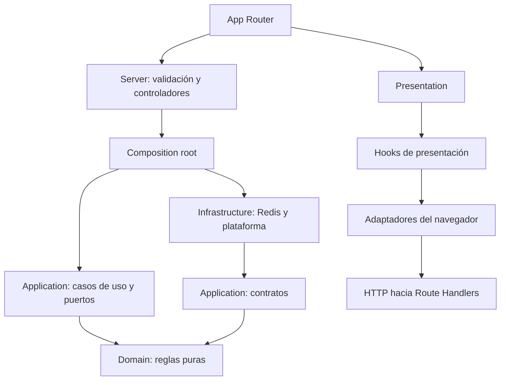

# Arquitectura de Rumbo Mundial

El proyecto conserva Next.js App Router, TypeScript estricto, Tailwind, Redis y los contratos HTTP existentes. Todo el código de la aplicación vive en `src/`; `public/`, pruebas, scripts y configuración permanecen en la raíz. No se agregaron servicios ni dependencias de producción.

## Estructura y dirección de dependencias

```text
src/
├── app/                     Rutas, metadata, layout y Route Handlers de Next
├── domain/
│   ├── game/                Estado, tablero, reglas y transiciones deterministas
│   ├── voice/               Reglas de presencia y señalización de voz
│   └── shared/              Errores independientes del transporte
├── application/
│   ├── ports/               Contratos de persistencia, identidad, reloj y azar
│   ├── rooms/               Crear, entrar, consultar y ejecutar acciones
│   └── voice/               Consultar y actualizar la sesión de voz
├── infrastructure/
│   ├── redis/               Implementaciones de los repositorios, CAS y TTL
│   ├── security/            UUID, hash y generador aleatorio de Node
│   ├── config/              Configuración de STUN y TURN
│   └── browser/             HTTP, localStorage, WebAudio y WebRTC
├── server/
│   ├── composition.ts       Conecta casos de uso y adaptadores
│   ├── http/                Validación Zod, controladores y traducción de errores
│   └── site.ts              URL pública y configuración SEO del servidor
└── presentation/
    ├── atoms/               Button, Input, PlayerMarker e ilustraciones
    ├── molecules/           TextField, Dialog, VolumeControl, BoardSquare, Dice
    ├── organisms/           Board, Lobby, PlayerPanel, AuctionPanel, Wallet, voz
    ├── templates/           RoomLayout: estructura visual sin reglas del juego
    ├── pages/               Home y Room: composición de pantallas
    ├── hooks/               Sesión, pagos, formularios, audio, voz y reproducción
    ├── services/            Cola de escenas, geometría y estimaciones de pago
    └── assets/              Mapeo de las ilustraciones de países
```



`domain` no importa React, Next, Redis, Zod ni código de otras capas. `application` depende exclusivamente del dominio y de sus propios contratos. Los adaptadores implementan esos contratos; los casos de uso reciben sus dependencias como argumentos. No hay contenedor de inyección ni localizador global de servicios.

`server/composition.ts` crea objetos sin estado de partida y los entrega a los controladores HTTP. Las salas siguen almacenándose exclusivamente en Redis. La presentación puede consultar funciones puras del dominio para explicar acciones y mostrar estimaciones; el servidor siempre vuelve a validar y ejecutar las reglas.

Los hooks conectan las pantallas con `infrastructure/browser`. Los componentes visuales no importan Redis, módulos de servidor ni adaptadores directamente. Las importaciones de tipos también respetan las fronteras. El alias `@/` apunta a `src/` en TypeScript, Next y Vitest.

## Responsabilidad única

| Módulo | Responsabilidad |
| --- | --- |
| `domain/game/engine.ts` | Validar y coordinar una acción sobre una copia del estado |
| `domain/game/factory.ts` | Crear jugadores y estado inicial |
| `domain/game/movement.ts`, `landing.ts` | Recorrido/detención y resolución de casillas/cartas, respectivamente |
| `domain/game/turns.ts`, `timing.ts` | Cambio de turno y vencimientos usando una hora inyectada |
| `domain/game/auctions.ts`, `trading.ts`, `bankruptcy.ts` | Adjudicación de subastas, validez de tratos y liquidación por quiebra |
| `domain/game/money.ts`, `rules.ts` | Billetes y operaciones monetarias; cálculos y elegibilidad de propiedades |
| `domain/game/events.ts`, `settlement.ts` | Registro de hechos; deudas y condición de victoria |
| `application/rooms/*.ts` | Un caso de uso por archivo, independiente de HTTP y Redis |
| `infrastructure/redis/room-repository.ts` | Lectura y escritura atómica del estado con TTL |
| `server/http/*-schemas.ts` | Validación de datos no confiables de las solicitudes |
| `server/http/errors.ts` | Convertir errores de aplicación a códigos HTTP |
| `presentation/hooks/useRoomSession.ts` | Polling, reconexión, heartbeat, versión y envío de acciones |
| `presentation/hooks/useRoomActions.ts` | Abrir la selección de billetes antes de enviar un pago |
| `presentation/services/payment-quote.ts` | Estimar el importe visible; no mueve dinero |
| `presentation/hooks/useVoiceChat.ts` | Ciclo de vida del micrófono y preferencias de voz |
| `presentation/organisms/VoiceChat.tsx` | Mostrar participantes y controles de la conversación |
| `presentation/organisms/PlayerRoster.tsx` | Consultar y paginar propiedades de otros jugadores |
| `presentation/pages/Room.tsx` | Componer la sala y coordinar la apertura de paneles |

Las funciones auxiliares del motor modifican únicamente la copia de trabajo recibida. La entrada pública `engine(state, action, playerId, context)` conserva su comportamiento determinista: no consulta servicios, reloj ni azar global. La política de duración de eventos en `domain/game/presentation.ts` se comparte con el cliente para que el servidor reserve tiempo de animación antes de iniciar la cuenta de la siguiente tirada.

## Diseño atómico y reutilización

Los niveles se definen por responsabilidad, no por el número de líneas:

- **Átomos:** elementos visuales independientes. `Button` centraliza variante, tipo, estado ocupado y motivo de deshabilitación; `Input` centraliza el estado de validez. Las ilustraciones se importan individualmente.
- **Moléculas:** pequeñas composiciones reutilizables. `TextField` asocia etiqueta y error a un ID único. `VolumeControl` se usa para música, efectos y voces. `Dialog` concentra apertura modal, foco nativo, Escape y suspensión durante las escenas. `ActionButton` muestra el motivo por el que una acción está bloqueada.
- **Organismos:** bloques completos con significado en la pantalla, como el tablero, las ofertas de trato o la cartera. Pueden componer organismos menores. `PlayerPanel` delega subastas e inventario; `Board` reutiliza `BoardSquare` para cada casilla.
- **Templates:** estructura y distribución visual. Reciben contenido y banderas de presentación; no ejecutan reglas ni solicitudes.
- **Pages:** conectan hooks y organismos. `src/app` compone estas páginas con las convenciones de Next y sus metadatos.

Se evitan componentes que importen niveles superiores: un átomo no conoce una pantalla y una molécula no conoce un organismo. Los átomos no importan reglas, casos de uso ni hooks del juego. Los organismos reciben datos y callbacks explícitos; no se añadió un estado global paralelo al servidor.

Ejemplo de uso de piezas existentes:

```tsx
import Button from "@/presentation/atoms/Button";
import TextField from "@/presentation/molecules/TextField";
import VolumeControl from "@/presentation/molecules/VolumeControl";

// Dentro de un componente de cliente con estado recibido por props o un hook:
<TextField label="Nombre" value={name} onChange={(event) => setName(event.target.value)} />
<VolumeControl label="Música" value={volume} onChange={setVolume} />
<Button type="submit" variant="primary" loading={saving}>Guardar</Button>
```

`Button` usa `type="button"` por defecto para que un control secundario no envíe un formulario. Los botones que envían formularios declaran `type="submit"`. Los diálogos de pago, trato y propiedad conservan sus clases CSS, formularios y comportamiento de suspensión; el componente compartido solo administra su contenedor modal.

## Agregar una función

1. Define la regla y sus datos en `domain`; prueba el resultado con contexto explícito.
2. Si requiere coordinación o persistencia, agrega el caso de uso en `application`. Reutiliza los puertos; extiéndelos solo cuando una operación real lo necesite.
3. Implementa cualquier acceso externo en `infrastructure` y conéctalo en `server/composition.ts`.
4. Valida la solicitud en `server/http`, y conserva un Route Handler pequeño en `src/app/api`.
5. Conecta el frontend mediante un hook. Reutiliza átomos y moléculas antes de crear una pieza nueva.
6. Ejecuta las comprobaciones descritas abajo. Evita clases base, repositorios genéricos y archivos de reexportación que oculten el módulo responsable.

## Compatibilidad de esta migración

No cambian las rutas públicas, los cuerpos HTTP, la versión del reglamento, el formato del estado, los hashes de tokens ni las claves `turista:` de Redis/localStorage. Tampoco cambian las credenciales necesarias. El contador y las claves de voz siguen separados del juego. No hay migración de Redis ni motivo para invalidar salas compatibles solo por reorganizar el código.

El CAS sigue comparando la versión y escribiendo en una sola ejecución Lua, con TTL de 24 horas para salas y 120 segundos para voz. Los recibos de acciones evitan duplicar efectos; una carrera devuelve 409. Los mazos y tokens permanecen fuera de las respuestas públicas. Los vencimientos se resuelven durante solicitudes, sin procesos residentes.

Al actualizar una copia existente, elimina las antiguas carpetas raíz `app/`, `components/` y `lib/` (ya eliminadas en este proyecto). No deben convivir `app/` y `src/app/`: Next prioriza la carpeta de la raíz. Si tu compilación local conserva tipos de las rutas viejas, elimina solo la caché `.next/` y vuelve a compilar. `public/` y la configuración permanecen en la raíz; el Root Directory de Vercel sigue siendo el proyecto, no `src`.

## Verificación

```sh
npm run check:architecture
npm test
npm run typecheck
npm run lint
npm run build
```

El comprobador analiza importaciones, reexportaciones e importaciones dinámicas con el AST de TypeScript. Rechaza dependencias de capas inversas, referencias al servidor desde la UI, efectos externos en dominio/aplicación, ciclos y jerarquía atómica invertida. `prebuild` lo ejecuta automáticamente. Los tests incluyen ejemplos deliberadamente incorrectos para comprobar que detecta las infracciones.

Las pruebas de reglas, temporizadores, partidas completas, concurrencia, tokens, voz y animaciones se mantienen. Las pruebas de voz usan repositorios y reloj inyectados; los tests de integración de salas ejercitan la composición y el adaptador Redis mediante un doble del cliente. Los dobles en memoria son exclusivos de pruebas.

Después del despliegue, verifica visualmente dos navegadores: crear/unirse, refrescar, dados y movimiento, comprar con billetes, subastas, tratos y voz. El build y las pruebas automatizadas no sustituyen la comprobación visual ni una llamada de micrófono entre redes reales.
